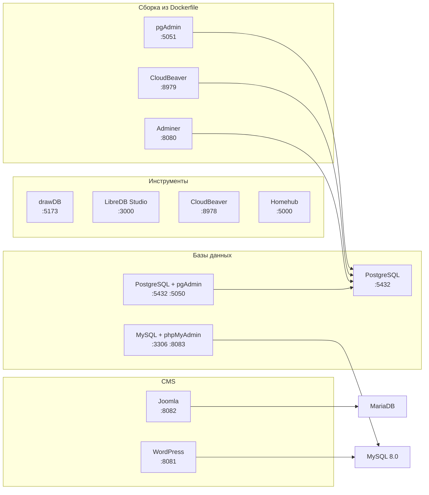

# Docker Compose: готовые стеки в одном репозитории

Подборка compose-конфигураций для быстрого развёртывания СУБД, CMS и веб-инструментов.
Каждый стек лежит в отдельном каталоге, запускается одной командой и не зависит от
остальных — поднимайте нужный, а не все сразу.

Всего **12 стеков**: 9 на готовых образах и 3 варианта, где веб-интерфейс собирается
из Dockerfile прямо в репозитории.

---

## Что внутри

| # | Стек | Состав | Порты |
|:-:|---|---|---|
| 1 | [`joomla`](joomla/) | Joomla 5 + MariaDB 11.5 | `8082` |
| 2 | [`wordpress`](wordpress/) | WordPress + MySQL 8.0 | `8081` |
| 3 | [`mysql-phpmyadmin`](mysql-phpmyadmin/) | MySQL 8.0 + phpMyAdmin | `3306`, `8083` |
| 4 | [`postgresql`](postgresql/) | PostgreSQL 15 + healthcheck | `5432` |
| 5 | [`postgresql-pgadmin`](postgresql-pgadmin/) | PostgreSQL 17 + pgAdmin 4 | `5432`, `5050` |
| 6 | [`drawdb`](drawdb/) | drawDB — редактор ER-схем | `5173` |
| 7 | [`libredb-studio`](libredb-studio/) | LibreDB Studio — веб-IDE | `3000` |
| 8 | [`homehub`](homehub/) | Homehub — семейный дашборд | `5000` |
| 9 | [`cloudbeaver`](cloudbeaver/) | CloudBeaver — веб-DBeaver | `8978` |
| 10 | [`postgresql-adminer`](dockerfile-projects/postgresql-adminer/) | PostgreSQL + Adminer (сборка) | `8080` |
| 11 | [`postgresql-cloudbeaver`](dockerfile-projects/postgresql-cloudbeaver-dockerfile/) | PostgreSQL + CloudBeaver (сборка) | `8979` |
| 12 | [`postgresql-pgadmin`](dockerfile-projects/postgresql-pgadmin-dockerfile/) | PostgreSQL + pgAdmin (сборка) | `5051` |

---

## Как это устроено



---

## Запуск

```bash
cd <имя-стека>
docker compose up -d
```

Частые команды внутри каталога стека:

```bash
docker compose ps -a        # состояние контейнеров и портов
docker compose logs -f      # логи в реальном времени
docker compose stop         # остановить, сохранив данные
docker compose down -v      # удалить контейнеры вместе с томами
```

Для стеков из `dockerfile-projects/` добавляется флаг сборки:

```bash
docker compose up -d --build
```

---

## Требования

* Docker Desktop либо Docker Engine + Compose v2;
* свободные порты: `3000`, `5000`, `5050`, `5051`, `5173`, `5432`, `8080`–`8083`, `8978`, `8979`;
* около 10 ГБ на диске под образы и данные.

---

## Структура

```text
Docker-Compose/
├── site/                 # визуальный каталог стеков (GitHub Pages)
├── tools/                # сверка каталога с compose-файлами
├── .github/workflows/    # проверка конфигураций и деплой сайта
├── joomla/
├── wordpress/
├── mysql-phpmyadmin/
├── postgresql/
├── postgresql-pgadmin/
├── drawdb/
├── libredb-studio/
├── homehub/
├── cloudbeaver/
├── dockerfile-projects/
│   ├── postgresql-adminer/
│   ├── postgresql-cloudbeaver-dockerfile/
│   └── postgresql-pgadmin-dockerfile/
└── README.md
```

---

## Визуальный каталог

<https://spleiii.github.io/Docker-Compose/>

Интерактивная карта всех стеков: состав сервисов, образы, порты, тома и
схема связей в виде чертежа. Стек выбирается кликом — рядом появляется его
схема и команда запуска с копированием в буфер. Есть поиск по имени или
порту и общая таблица занятых портов.

Сайт собран на голом HTML, CSS и JavaScript: ни сборщика, ни зависимостей.

---

## Автоматические проверки

| Пайплайн | Что делает |
|---|---|
| `validate-compose.yml` | прогоняет `docker compose config` по каждому compose-файлу и сверяет каталог сайта с реальными конфигурациями |
| `deploy-site.yml` | публикует каталог из `site/` на GitHub Pages |

Сверка каталога — не формальность: если в compose-файле поменяется образ или
порт, а `site/catalog.js` останется прежним, сборка упадёт с понятным
сообщением.

---

## Что изменилось относительно исходной коллекции

| Было | Стало |
|---|---|
| README в стиле лабораторной работы | единый формат: состав стека, запуск, доступ, параметры БД, скриншоты, управление |
| скриншоты с кириллическими именами в корне каталогов | `docs/NN-<стек>.png` с латинскими именами |
| каталог стеков только в тексте | интерактивный визуальный каталог с SVG-схемами |
| проверок не было | CI: валидация compose-файлов и сверка каталога |
| у `wordpress` не было compose-файла | файл дописан по описанию стека |

Compose-файлы, Dockerfile, `init.sql` и `config.yml` перенесены без изменений.

---

## Лицензия

Учебный проект. Образы, исходный код приложений и торговые марки принадлежат
их правообладателям.
