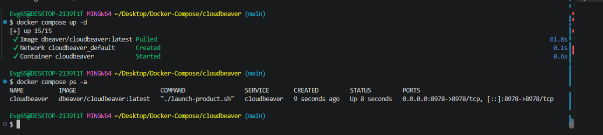
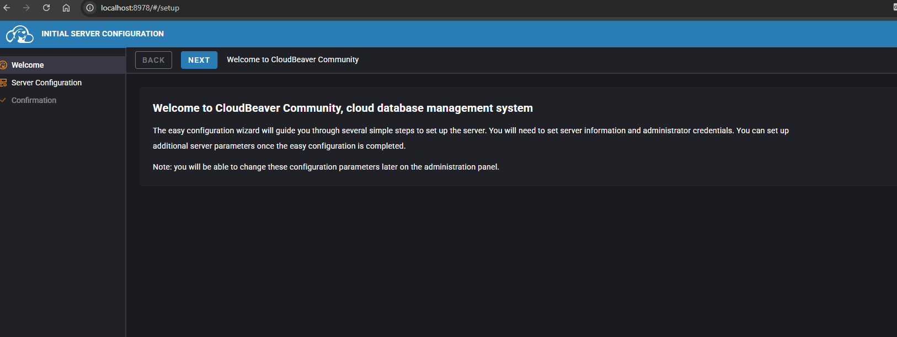
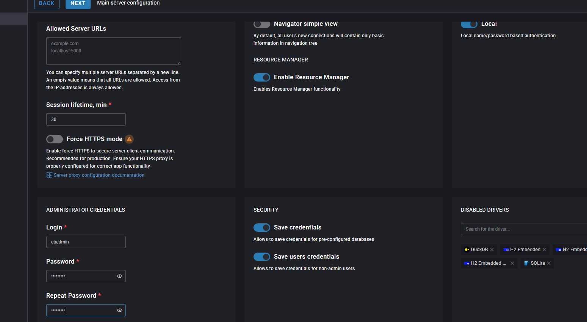

# CloudBeaver

Веб-версия DBeaver: полноценная работа с PostgreSQL, MySQL, SQLite и другими
СУБД прямо из браузера — подключения, SQL-запросы, структура таблиц и выгрузка
данных.

---

## Состав стека

| Сервис | Образ | Порт | Роль |
|---|---|---|---|
| `cloudbeaver` | `dbeaver/cloudbeaver:latest` | `8978` | веб-интерфейс |

Каталог `./workspace` монтируется внутрь контейнера — подключения, настройки и
сессии переживают перезапуск.

---

## Запуск

```bash
docker compose up -d
docker compose ps -a
```

---

## Доступ

<http://localhost:8978>

При первом открытии запускается мастер первоначальной настройки — нужно
завести учётную запись администратора:

| Параметр | Требование |
|---|---|
| Логин | любой, например `cbadmin` |
| Пароль | не меньше 8 символов, минимум одна заглавная и одна строчная буква |

---

## Подключение к базе

После авторизации открывается рабочее пространство: слева дерево навигации по
базам, справа SQL-редактор. Адреса серверов добавляются через **New
Connection** — для базы из соседнего стека указывайте её имя в сети, например
`db`, и порт `5432`.

---

## Скриншоты

<details>
<summary>Показать запуск и настройку</summary>

Запуск контейнера:



Создание администратора:



Рабочее пространство:



</details>

---

## Управление

```bash
docker compose logs -f cloudbeaver
docker compose stop
docker compose down
```

---

[← к списку стеков](../README.md)
