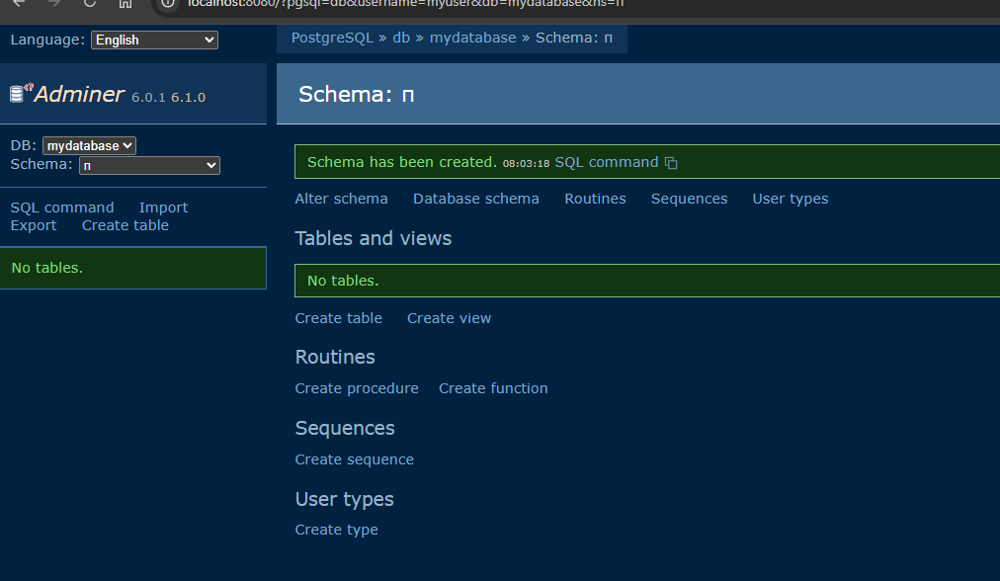
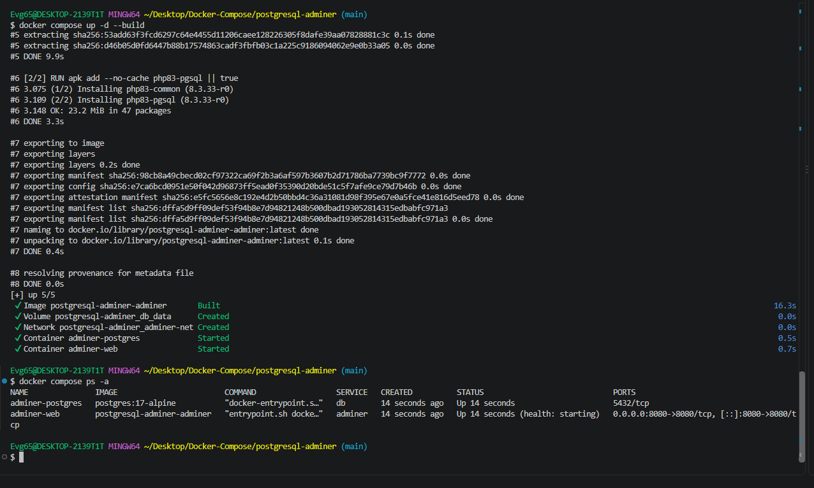
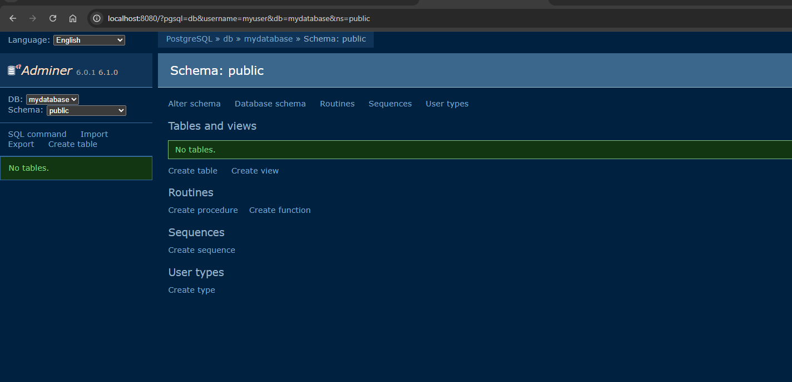

# PostgreSQL + Adminer

Adminer — универсальный веб-клиент для СУБД на PHP: PostgreSQL, MySQL,
SQLite, Oracle. Здесь образ Adminer собирается **из собственного Dockerfile**:
в официальный образ добавляется драйвер PostgreSQL.

---

## Состав стека

| Сервис | Образ | Порт | Роль |
|---|---|---|---|
| `db` | `postgres:17-alpine` | — | база данных |
| `adminer` | собирается из `Dockerfile` | `8080` | веб-клиент |

Сервисы соединены в сети `adminer-net`, данные базы лежат в томе `db_data`.

---

## Что делает Dockerfile

```dockerfile
FROM adminer:latest

USER root

# Устанавливаем драйвер PostgreSQL для Adminer
RUN apk add --no-cache php83-pgsql || true

USER adminer

EXPOSE 8080

HEALTHCHECK --interval=30s --timeout=10s --retries=3 \
  CMD wget --spider -q http://localhost:8080 || exit 1
```

Ключевое: официальный образ Adminer собран на Alpine и **не содержит**
драйвера PostgreSQL — без `apk add` подключиться к базе не получится.
`|| true` в конце команды нужен на образах, где пакет уже установлен.

---

## Сборка и запуск

```bash
docker compose up -d --build
docker compose ps -a
```

> Флаг `--build` обязателен: без него Docker возьмёт готовый образ из
> реестра, а не соберёт ваш Dockerfile.

---

## Доступ

<http://localhost:8080>

Параметры подключения:

| Параметр | Значение |
|---|---|
| System | `PostgreSQL` |
| Server | `db` |
| Username | `myuser` |
| Password | `mypassword` |
| Database | `mydatabase` |

---

## Скриншоты

<details>
<summary>Показать сборку и работу в Adminer</summary>

Сборка и запуск:



Экран входа:



База данных:



</details>

---

## Управление

```bash
docker compose logs -f adminer
docker compose down --rmi all -v   # вместе с образом и томами
```

---

[← к списку стеков](../../README.md)
