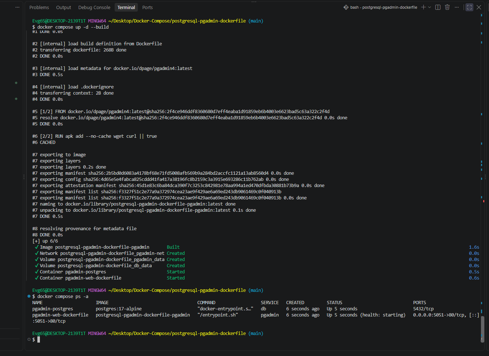
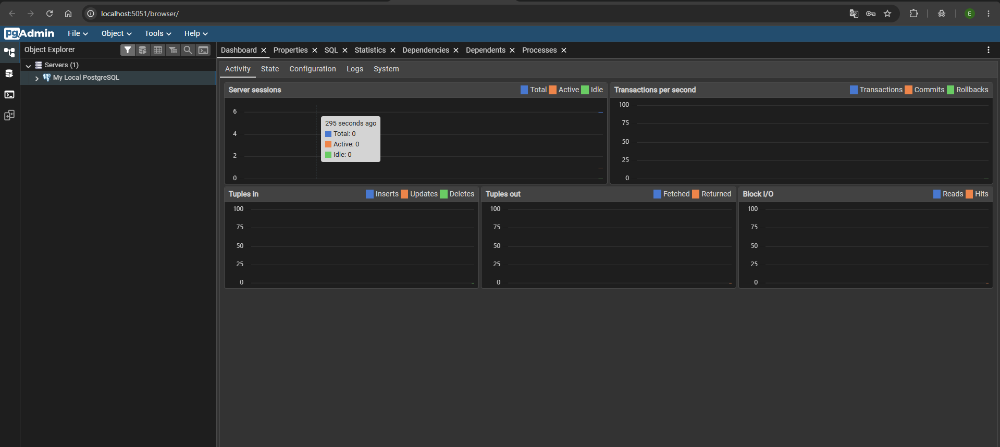
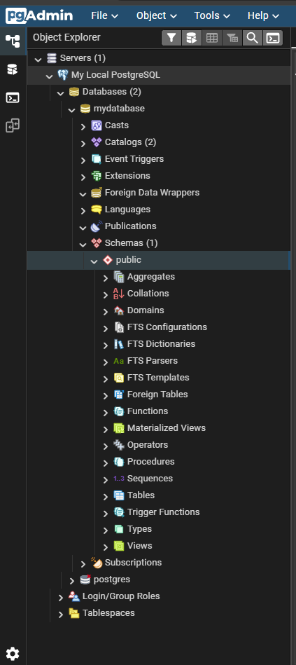

# PostgreSQL + pgAdmin

pgAdmin 4 — официальный веб-клиент для администрирования PostgreSQL. Здесь
образ собирается **из собственного Dockerfile**: в официальный `dpage/pgadmin4`
добавляются `wget` и `curl` для встроенного healthcheck.

---

## Состав стека

| Сервис | Образ | Порт | Роль |
|---|---|---|---|
| `db` | `postgres:17-alpine` | — | база данных |
| `pgadmin` | собирается из `Dockerfile` | `5051` → 80 | веб-интерфейс |

Сеть — `pgadmin-net`, данные базы и настройки pgAdmin лежат в томах
`db_data` и `pgadmin_data`.

---

## Что делает Dockerfile

```dockerfile
FROM dpage/pgadmin4:latest

USER root

RUN apk add --no-cache wget curl || true

EXPOSE 80

HEALTHCHECK --interval=30s --timeout=10s --retries=3 --start-period=40s \
  CMD wget --spider -q http://localhost:80/misc/ping || exit 1
```

Официальный образ основан на Alpine и не содержит `wget`, поэтому проверка
доступности в нём невозможна — утилиту нужно доустановить вручную.

---

## Сборка и запуск

```bash
docker compose up -d --build
docker compose ps -a
```

> Флаг `--build` обязателен: без него Docker возьмёт готовый образ из
> реестра, а не соберёт ваш Dockerfile.

---

## Доступ

<http://localhost:5051>

Данные для входа в интерфейс:

| Параметр | Значение |
|---|---|
| Email | `admin@example.com` |
| Password | `admin` |

---

## Подключение к PostgreSQL

Сервер добавляется через **Register → Server**:

| Настройка | Значение |
|---|---|
| Host name/address | `db` |
| Port | `5432` |
| Maintenance database | `mydatabase` |
| Username | `myuser` |
| Password | `mypassword` |

---

## Скриншоты

<details>
<summary>Показать сборку и работу в pgAdmin</summary>

Сборка и запуск:



Подключение к PostgreSQL:



База данных:



</details>

---

## Управление

```bash
docker compose logs -f pgadmin
docker compose down --rmi all -v   # вместе с образом и томами
```

---

[← к списку стеков](../../README.md)
