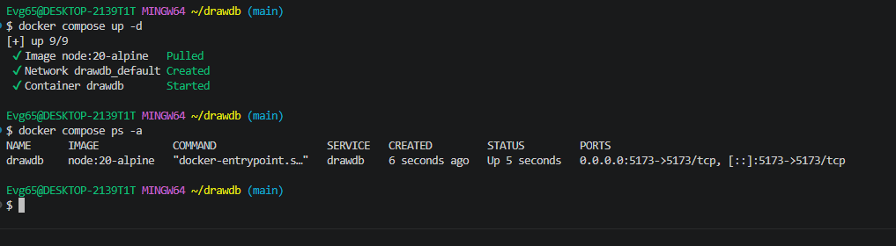
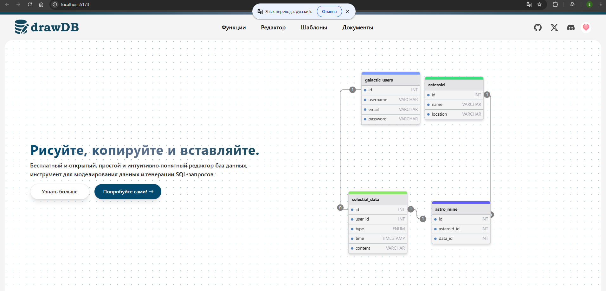
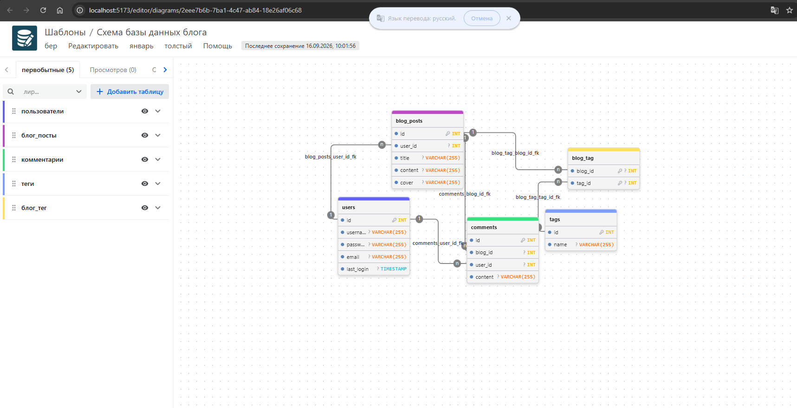

# drawDB

Бесплатный браузерный редактор ER-диаграмм: рисуете сущности и связи, на
выходе получаете готовый SQL.

Собран из официальных исходников — <https://github.com/drawdb-io/drawdb>.
В compose-файле описан не готовый образ, а окружение для разработки: Node
разворачивает проект и запускает Vite в режиме dev.

---

## Состав стека

| Сервис | Образ | Порт | Роль |
|---|---|---|---|
| `drawdb` | `node:20-alpine` | `5173` | dev-сервер Vite |

Каталог проекта монтируется в `/var/www/html`, команда контейнера выполняет
`npm install && npm run dev -- --host`. Установка зависимостей при первом
запуске занимает несколько минут.

---

## Запуск

```bash
docker compose up -d
docker compose logs -f drawdb   # следить за установкой пакетов
docker compose ps -a
```

---

## Доступ

<http://localhost:5173>

На главной странице можно начать с нуля или открыть готовый демонстрационный
шаблон.

---

## Что умеет редактор

* создание таблиц с колонками, типами и ключами;
* связи «один ко многим» и «многие ко многим»;
* индексы и внешние ключи;
* экспорт схемы в SQL для PostgreSQL, MySQL, SQLite, Oracle и других СУБД.

---

## Скриншоты

<details>
<summary>Показать запуск и редактор</summary>

Запуск контейнера:



Главная страница:



Редактор диаграммы:



</details>

---

## Управление

```bash
docker compose logs -f drawdb
docker compose stop
docker compose down
```

---

[← к списку стеков](../README.md)
