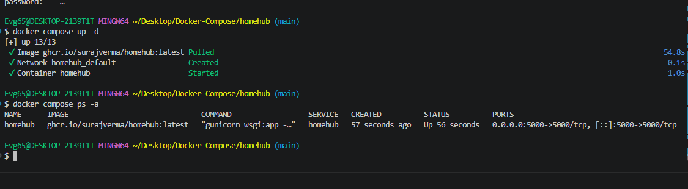
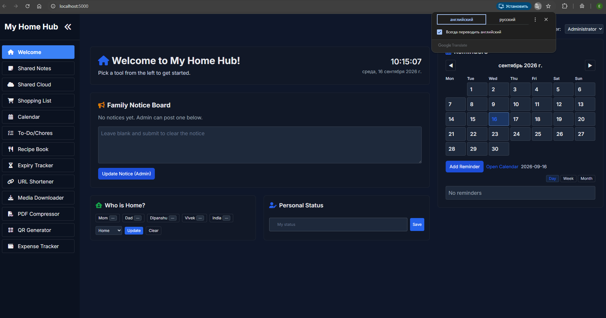
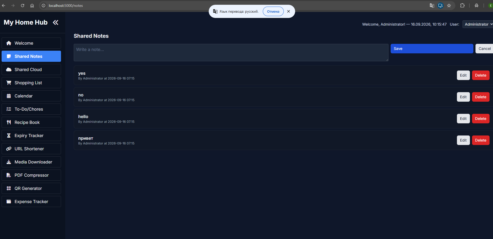

# Homehub

Семейная панель управления для домашней сети: заметки, списки покупок, домашние
дела, загрузка медиафайлов, трекер расходов и сокращатель ссылок.

Исходный код: <https://github.com/surajverma/homehub>.

---

## Состав стека

| Сервис | Образ | Порт | Роль |
|---|---|---|---|
| `homehub` | `ghcr.io/surajverma/homehub:latest` | `5000` | веб-приложение |

Пользовательские данные лежат прямо в каталоге проекта: `uploads/`, `media/`,
`pdfs/` и `data/` монтируются внутрь контейнера, а `config.yml` подключается
только на чтение.

---

## Настройка

Файл `config.yml` задаёт название инстанса, состав семьи, список включённых
модулей и тему оформления. В текущей конфигурации активны:

`shopping_list` · `media_downloader` · `pdf_compressor` · `qr_generator` ·
`notes` · `shared_cloud` · `who_is_home` · `personal_status` · `chores` ·
`recipes` · `expiry_tracker` · `url_shortener` · `expense_tracker`

Чтобы убрать модуль, достаточно поставить `false` рядом с его названием.

Переменная `SECRET_KEY` передаётся через окружение и берётся из `.env`:

```dotenv
SECRET_KEY=любая-длинная-строка
```

---

## Запуск

```bash
docker compose up -d
docker compose ps -a
```

---

## Доступ

<http://localhost:5000>

После старта открывается главная панель со всеми включёнными виджетами.

---

## Скриншоты

<details>
<summary>Показать запуск и модули</summary>

Запуск контейнера:



Главная панель:



Один из модулей:



</details>

---

## Управление

```bash
docker compose logs -f homehub
docker compose stop
docker compose down
```

Каталоги `uploads/`, `media/`, `pdfs/` и `data/` остаются на месте — данные
не пропадут.

---

[← к списку стеков](../README.md)
