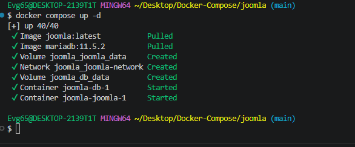
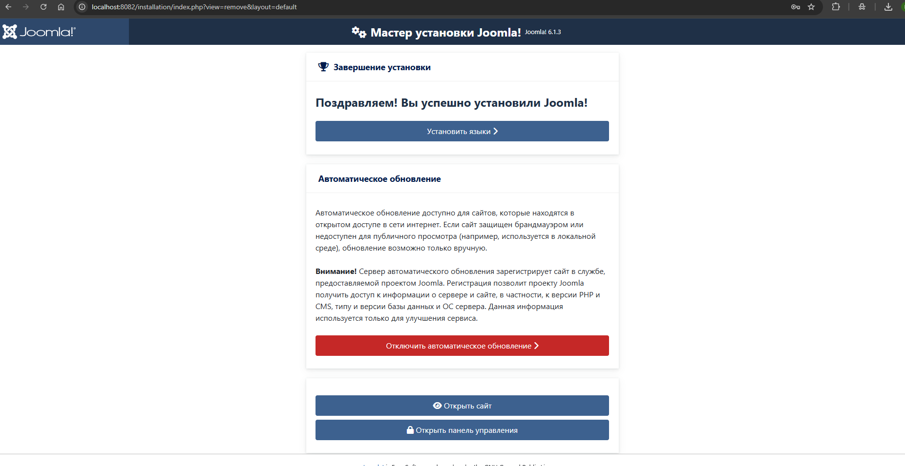

# Joomla

CMS на PHP с открытым исходным кодом. В этом каталоге — готовый compose-файл,
который поднимает Joomla вместе с базой MariaDB и соединяет их внутренней
сетью.

---

## Состав стека

| Сервис | Образ | Порт | Роль |
|---|---|---|---|
| `joomla` | `joomla:latest` | `8082` → 80 | веб-приложение |
| `db` | `mariadb:11.5.2` | — | база данных |

Сервисы объединены в сеть `joomla-network` и общаются по внутреннему имени
`db`. Данные лежат в именованных томах `joomla_data` и `db_data`.

---

## Запуск

```bash
docker compose up -d
docker compose ps -a
```

Первый запуск займёт минуту — образы тянутся из Docker Hub.

---

## Доступ

| Что | Адрес |
|---|---|
| Сайт | <http://localhost:8082> |
| Панель администратора | <http://localhost:8082/administrator> |

---

## Подключение к базе

При первом входе откроется мастер настройки. Вводите такие параметры:

| Параметр | Значение |
|---|---|
| Тип базы | `MySQLi` |
| Хост | `db` |
| Пользователь | `joomla_user` |
| Пароль | `joomla_password` |
| Имя базы | `joomla_db` |

> Хост указывается как `db`, а не `localhost`: внутри сети контейнеров так
> называется сервис базы данных.

---

## Скриншоты

<details>
<summary>Показать шаги установки</summary>

Создание сайта:



Установка:



</details>

---

## Управление

| Действие | Команда |
|---|---|
| Логи приложения | `docker compose logs -f joomla` |
| Логи базы | `docker compose logs -f db` |
| Остановить | `docker compose stop` |
| Запустить снова | `docker compose start` |
| Перезапустить | `docker compose restart` |
| Проверить конфигурацию | `docker compose config` |

---

## Удаление

```bash
# убрать контейнеры вместе с томами — данные будут потеряны
docker compose down -v
```

---

[← к списку стеков](../README.md)
