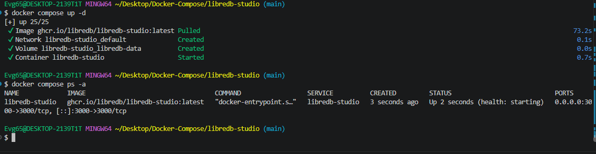
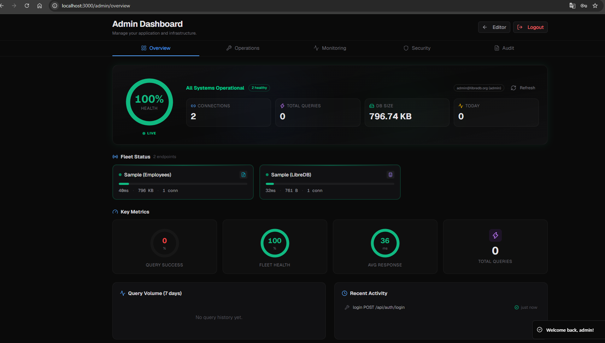
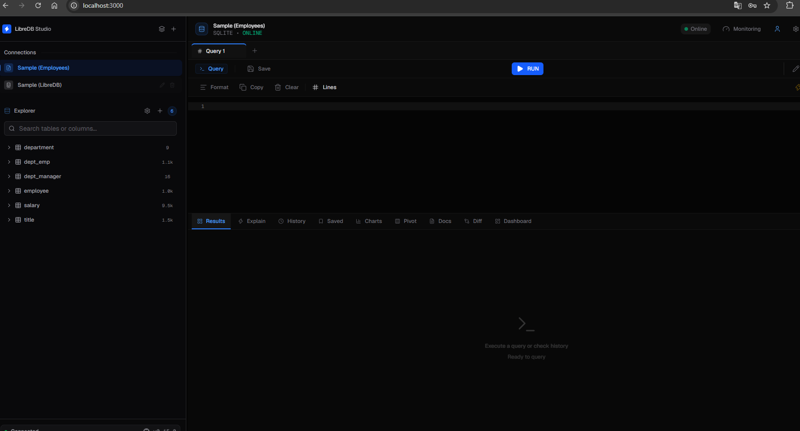

# LibreDB Studio

Открытая (MIT) веб-IDE для работы с базами данных — браузерный аналог
DataGrip и DBeaver. Разворачивается рядом с целевыми СУБД и даёт единую точку
входа для запросов, визуализации данных и администрирования.

Исходный код: <https://github.com/libredb/libredb-studio>.

---

## Состав стека

| Сервис | Образ | Порт | Роль |
|---|---|---|---|
| `libredb-studio` | `ghcr.io/libredb/libredb-studio:latest` | `3000` | веб-IDE |

Данные студии хранятся в именованном томе `libredb-data`. Healthcheck
проверяет доступность интерфейса через `wget --spider` каждые 30 секунд.

---

## Подготовка

Compose-файл требует два обязательных секрета — без них контейнер не
стартует. Создайте `.env` в этом каталоге:

```dotenv
ADMIN_EMAIL=admin@libredb.org
ADMIN_PASSWORD=YourStrongPassword123!
JWT_SECRET=любая-строка-не-короче-32-символов
```

Значение по умолчанию есть только у `ADMIN_EMAIL`; остальные два задаются
явно, иначе compose прервётся с ошибкой.

---

## Запуск

```bash
docker compose up -d
docker compose ps -a
```

---

## Доступ

<http://localhost:3000>

Данные для входа администратора берутся из `.env`:

| Параметр | Значение по умолчанию |
|---|---|
| Логин | `admin@libredb.org` |
| Пароль | то, что задано в `ADMIN_PASSWORD` |

После входа открывается дашборд со сводкой по системе, числом активных
сессий и списком подключённых источников.

---

## Работа с базами

В редакторе запросов настраиваются подключения к PostgreSQL, MySQL, SQLite и
другим СУБД. Для быстрого знакомства доступны демонстрационные базы
`Sample (Employees)` и `Sample (LibreDB)`.

---

## Скриншоты

<details>
<summary>Показать запуск, дашборд и редактор</summary>

Запуск контейнера:



Административный дашборд:



Рабочее пространство редактора:



</details>

---

## Управление

```bash
docker compose logs -f libredb-studio
docker compose stop
docker compose down -v
```

---

[← к списку стеков](../README.md)
