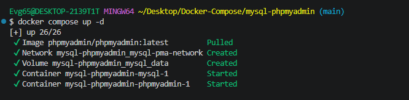
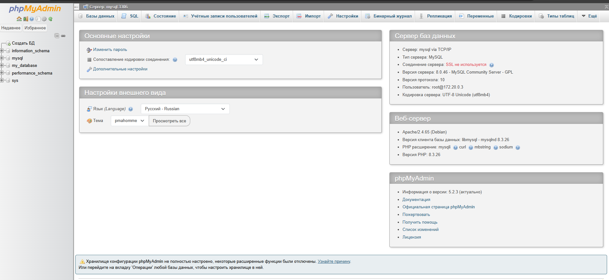
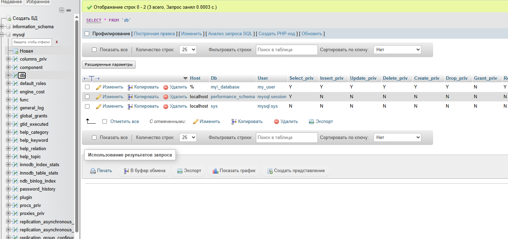

# MySQL + phpMyAdmin

Готовая среда для работы с MySQL прямо в браузере: сама СУБД и веб-панель
phpMyAdmin в одной сети `mysql-pma-network`.

---

## Состав стека

| Сервис | Образ | Порт | Роль |
|---|---|---|---|
| `mysql` | `mysql:8.0` | `3306` → 3306 | база данных |
| `phpmyadmin` | `phpmyadmin/phpmyadmin:latest` | `8083` → 80 | веб-клиент |

phpMyAdmin подключается к базе по внутреннему имени `mysql` — порт
`PMA_HOST` уже настроен, вручную ничего указывать не нужно.

---

## Запуск

```bash
docker compose up -d
docker compose ps -a
```

---

## Доступ

| Что | Адрес |
|---|---|
| phpMyAdmin | <http://localhost:8083> |
| MySQL напрямую | `localhost:3306` |

Данные для входа в phpMyAdmin:

| Параметр | Значение |
|---|---|
| Сервер | `mysql` |
| Пользователь | `root` |
| Пароль | `root` |

Подключиться к базе из терминала:

```bash
docker exec -it <контейнер-mysql> mysql -uroot -proot
```

---

## Что уже создано

При старте контейнера MySQL автоматически появляется база `my_database` и
пользователь `my_user`. Через phpMyAdmin можно заводить таблицы, выполнять
запросы, импортировать и выгружать дампы.

---

## Скриншоты

<details>
<summary>Показать запуск и работу в phpMyAdmin</summary>

Запуск контейнеров:



Вход в phpMyAdmin:



База данных в интерфейсе:



</details>

---

## Управление

```bash
docker compose logs -f mysql
docker compose logs -f phpmyadmin
docker compose stop
docker compose down -v          # вместе с данными базы
```

---

[← к списку стеков](../README.md)
