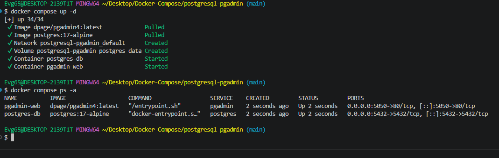
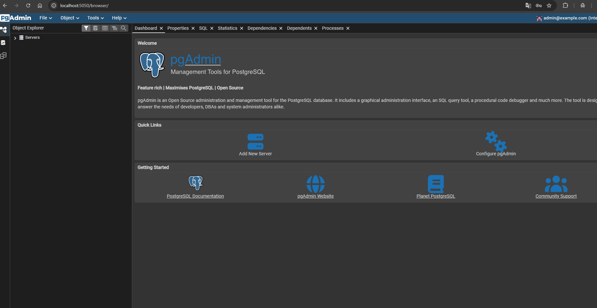
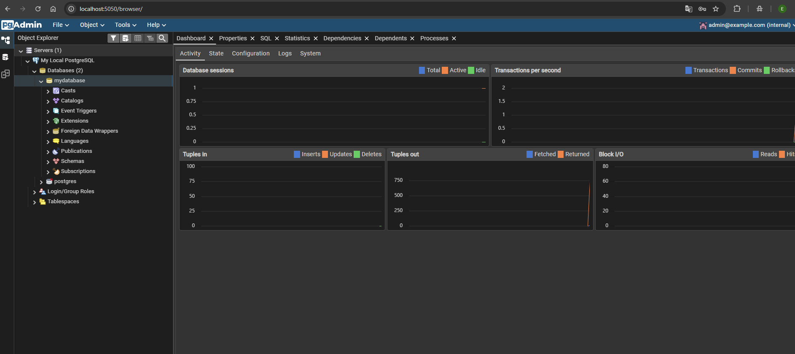

# PostgreSQL + pgAdmin

Современная СУБД PostgreSQL 17 и официальный веб-интерфейс pgAdmin 4 в одном
compose-файле. База работает на лёгком alpine-образе, интерфейс доступен из
браузера.

---

## Состав стека

| Сервис | Образ | Порт | Роль |
|---|---|---|---|
| `postgres` | `postgres:17-alpine` | `5432` → 5432 | база данных |
| `pgadmin` | `dpage/pgadmin4:latest` | `5050` → 80 | веб-интерфейс |

Данные базы сохраняются в именованном томе `postgres_data` и переживают
пересоздание контейнера.

---

## Запуск

```bash
docker compose up -d
docker compose ps -a
```

---

## Доступ

| Что | Адрес |
|---|---|
| pgAdmin | <http://localhost:5050> |
| PostgreSQL | `localhost:5432` |

Данные для входа в pgAdmin:

| Параметр | Значение |
|---|---|
| Email | `admin@example.com` |
| Пароль | `admin` |

---

## Подключение базы в pgAdmin

Сервер PostgreSQL добавляется вручную — нажмите **Add New Server** и укажите:

| Параметр | Значение |
|---|---|
| Host name | `postgres-db` |
| Port | `5432` |
| Maintenance database | `mydatabase` |
| Username | `myuser` |
| Password | `mypassword` |

> В поле Host указывается имя **контейнера** `postgres-db` — именно так он
> называется в compose-файле. Внутренний порт базы не меняется.

---

## Скриншоты

<details>
<summary>Показать запуск и подключение в pgAdmin</summary>

Запуск контейнеров:



Подключение сервера:



Работа с базой:



</details>

---

## Управление

```bash
docker compose logs -f postgres
docker compose logs -f pgadmin
docker compose stop
docker compose down -v
```

---

[← к списку стеков](../README.md)
