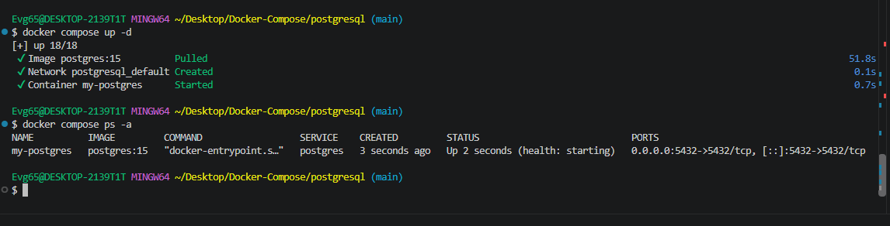
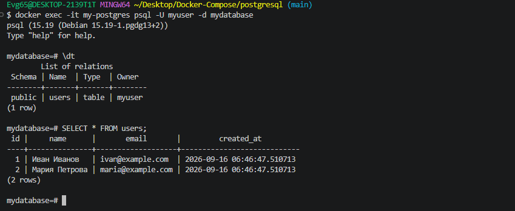
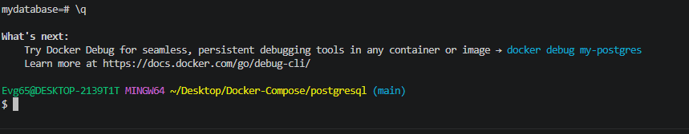

# PostgreSQL

Одиночный контейнер с PostgreSQL 15: healthcheck для контроля готовности и
SQL-скрипт, который выполняется только при самом первом запуске.

---

## Состав стека

| Сервис | Образ | Порт | Роль |
|---|---|---|---|
| `postgres` | `postgres:15` | `5432` → 5432 | база данных |

Данные лежат в локальном каталоге `./data` — их видно в файловой системе, а
не внутри именованного тома. Рядом монтируются `./backups` для дампов и
`./scripts/init.sql`, который выполняется при инициализации.

---

## Запуск

```bash
docker compose up -d
docker compose ps -a
```

Healthcheck использует `pg_isready`, поэтому в `docker compose ps` контейнер
дойдёт до состояния `healthy`, когда база реально готова принимать запросы.

---

## Подключение

```bash
docker exec -it my-postgres psql -U myuser -d mydatabase
```

| Параметр | Значение |
|---|---|
| База данных | `mydatabase` |
| Пользователь | `myuser` |
| Пароль | `mypassword` |

---

## Что создаёт init.sql

Скрипт выполняется один раз — при первом запуске пустого каталога `./data`:

* база `app_db` и пользователь `app_user` с правами на неё;
* таблица `users` в базе `mydatabase` с колонками `id`, `name`, `email`,
  `created_at`;
* две тестовые записи.

> Чтобы скрипт отработал заново, удалите содержимое `./data` и перезапустите
> контейнер.

---

## Скриншоты

<details>
<summary>Показать запуск, работу и логи</summary>

Запуск контейнера:



Работа в psql:



Логи запуска PostgreSQL:



</details>

---

## Управление

```bash
docker compose logs -f postgres
docker compose stop
docker compose start
docker compose down          # каталог ./data остаётся на месте
docker compose down -v
```

---

[← к списку стеков](../README.md)
