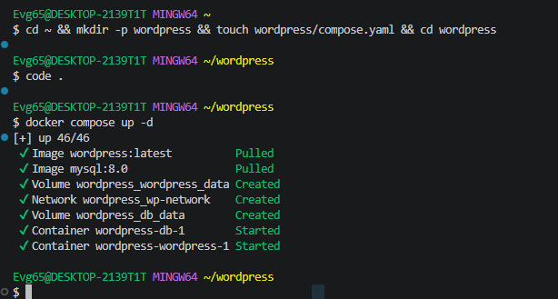
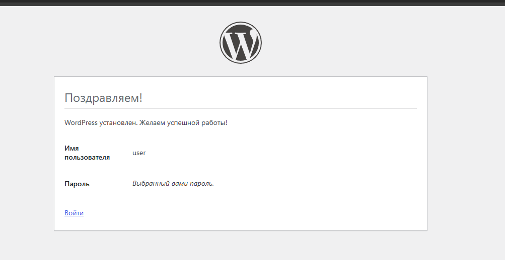
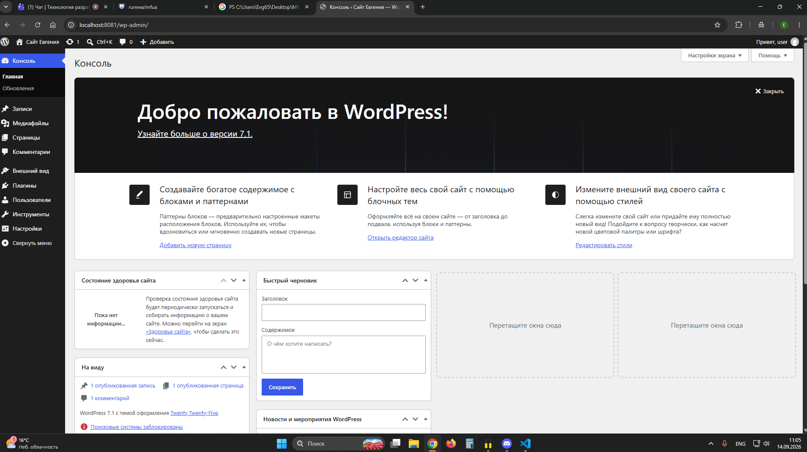
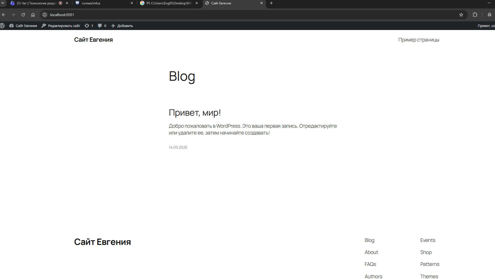

# WordPress

Самая популярная CMS в мире на PHP. В каталоге — compose-файл, который
поднимает WordPress и MySQL 8.0 в общей сети `wp-network`.

> В исходной коллекции этот каталог содержал только скриншоты и описание:
> сам `compose.yaml` не был закоммичен. Файл дописан по описанию стека —
> сервисы `db` и `wordpress`, сеть `wp-network`, тома для базы и содержимого
> сайта.

---

## Состав стека

| Сервис | Образ | Порт | Роль |
|---|---|---|---|
| `wordpress` | `wordpress:latest` | `8081` → 80 | веб-приложение |
| `db` | `mysql:8.0` | — | база данных |

---

## Запуск

```bash
docker compose up -d
docker compose ps -a
```

---

## Доступ

| Что | Адрес |
|---|---|
| Сайт | <http://localhost:8081> |
| Панель администратора | <http://localhost:8081/wp-admin/> |

При первом открытии запускается штатный установщик WordPress: выберите язык,
задайте имя сайта и создайте учётную запись администратора.

---

## Параметры базы

Установщик спросит их автоматически — значения уже прописаны в `compose.yaml`:

| Параметр | Значение |
|---|---|
| Хост | `db` |
| Пользователь | `wordpress_user` |
| Пароль | `wordpress_password` |
| Имя базы | `wordpress_db` |

---

## Скриншоты

<details>
<summary>Показать развёртывание и работу сайта</summary>

Запуск контейнеров:



Установщик WordPress:



Панель администратора:



Главная страница сайта:



</details>

---

## Управление

```bash
docker compose logs -f wordpress   # логи приложения
docker compose logs -f db          # логи базы
docker compose stop                # остановить
docker compose start               # запустить снова
docker compose down -v             # удалить вместе с томами
```

---

[← к списку стеков](../README.md)
